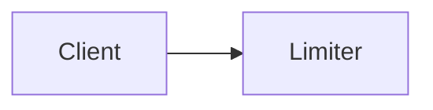
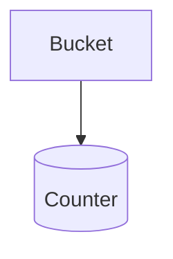

<!-- plan-gh:plan v1 -->
<details>
<summary>Metadata</summary>

<!-- plan-gh:meta -->
| Field | Value |
| --- | --- |
| created | 2026-10-23T09:00:00+08:00 |
| modified | 2026-10-23T09:00:00+08:00 |
| commits | none |
| agent name | copilot |
| session id | s1 |
| back refs | none |
| forward refs | none |
<!-- /plan-gh:meta -->

</details>



_Hero._

## Purpose

Rate limit search.

## Implementation Phases

### Phase 1: Limiter · `idle`

Add a token bucket per client.



_The bucket._

#### 1. Bucket

- [ ] Add TokenBucket — assert: `TokenBucket(2).take()` returns False on the third call
- [ ] Refill over time — assert: after one refill interval `TokenBucket(2).take()` returns True again

#### 2. Testing Strategy

pytest.

- [ ] `uv run pytest tests/test_limiter.py` — the bucket works

### Phase 2: Wire into search · `idle`

#### 1. Endpoint

- [ ] Reject over-limit requests — assert: the third request from one client to `search()` within a second gets status 429

#### 2. Testing Strategy

- [ ] `uv run pytest tests/test_search.py` — search enforces the limit

## Validation Commands

- [ ] `uv run pytest` — everything passes

## Notes

```
## Not a section
- [ ] not a task
```

## Amendments

<!-- plan-gh:amendments -->
_No amendments yet._
